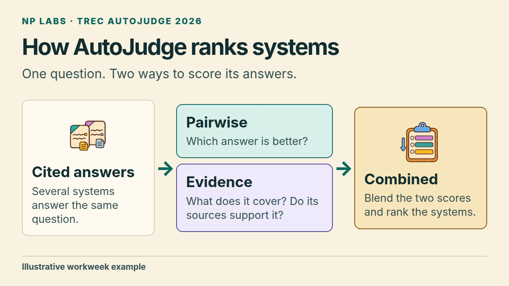

# NP Labs · TREC AutoJudge 2026

TREC AutoJudge measures how closely automated judges reproduce the official
rankings of answer systems. We submitted three approaches built with
GPT-6 Luna to both the RAG and RAGTIME tracks, for six confirmed TIRA submissions.

## [Project site](https://npatta01.github.io/trec-auto-judge-2026/)

[](https://npatta01.github.io/trec-auto-judge-2026/#architecture)

**[Watch the approach](https://npatta01.github.io/trec-auto-judge-2026/#architecture)** · 34 seconds · [MP4](https://npatta01.github.io/trec-auto-judge-2026/docs/assets/autojudge-approach.mp4)

- [Slides](https://npatta01.github.io/trec-auto-judge-2026/docs/paper/slides/talk.html) — follow the worked example and organizer results. Use **Edit slides** and **Download HTML** to save an editable offline copy.
- [Notebook paper](https://npatta01.github.io/trec-auto-judge-2026/docs/paper/autojudge2026.pdf) — judging protocol, scoring formulas, and submitted run IDs.
- [Architecture walkthrough](https://npatta01.github.io/trec-auto-judge-2026/docs/submission-architecture.html) — interactive scoring branches with illustrative submission metadata.
- [Results](https://npatta01.github.io/trec-auto-judge-2026/#results) and [Deep dive](https://npatta01.github.io/trec-auto-judge-2026/#deep-dive) — the track scores, rating fit, and worked answer grades.

## How the judges work

| Approach | How it scores answers |
| --- | --- |
| **Pairwise** | Compare selected pairs in both orders. Use Bradley–Terry to estimate each answer’s win chances. |
| **Evidence** | Build a shared checklist for each question. Grade coverage and citation support separately, then combine the grades using our Evidence formula for that track. |
| **Combined** | Give the Pairwise and Evidence scores equal weight. |

We average each system’s answer scores across questions to rank systems. The
[paper](docs/paper/README.md) explains the track-specific scoring.

## Organizer results

| Track | Our best reported measure | Rank agreement (`tauap_b`) |
| --- | --- | ---: |
| RAG | Request coverage | 0.573318 |
| RAGTIME | Full support from the first citation | 0.584562 |

A score of 1 means full agreement with the host track’s official ranking.
The reported RAGTIME measure (`RAGTIME_SENTENCE_SUPPORT_PROXY`) scores each
answer by the fraction of its segments fully supported by their first citation.
The resulting ranking placed our `ntp-combined-v1` run in the overall top five.
See the [organizer results and score tables](docs/organizer-results-2026-11-13.md)
and the [TIRA submission ledger](docs/submission-ledger.md).

## Development

This repository builds on the [TREC AutoJudge starter kit](https://github.com/trec-auto-judge/auto-judge-starterkit).
The [document support workflow](docs/document-pipeline.md) describes the
citation-scoring code in [`judges/generic/`](judges/generic/). The
[slide source and build instructions](docs/paper/slides/README.md) explain how to
rebuild the deck with Quarto. To regenerate the approach video and poster
from the [storyboard](docs/approach-storyboard.html), use Node.js with
Playwright’s Chromium and FFmpeg with `libx264` support.

```bash
node scripts/render_approach_video.cjs
```

For a system Chromium, set `CHROMIUM_PATH` to its executable.

With Python 3.10+ and `uv`, run the starter kit’s deterministic smoke test on
the synthetic `kiddie` dataset:

```bash
uv venv
source .venv/bin/activate
uv pip install -e '.[all]'
bash run_kiddie.sh
```

The smoke test writes results to `output-kiddie/` and needs no model endpoint.
See the [Participant HowTo](https://github.com/trec-auto-judge/.github/blob/main/profile/howto/README.md)
for setup, workflows, model configuration, and TIRA. Read the
[organizer data-handling policy](https://github.com/trec-auto-judge/.github/blob/main/profile/howto/data-policy.md)
before working with evaluation data. Use the organizer’s `scrub` tool to
diagnose failures on restricted records.

## License

MIT
