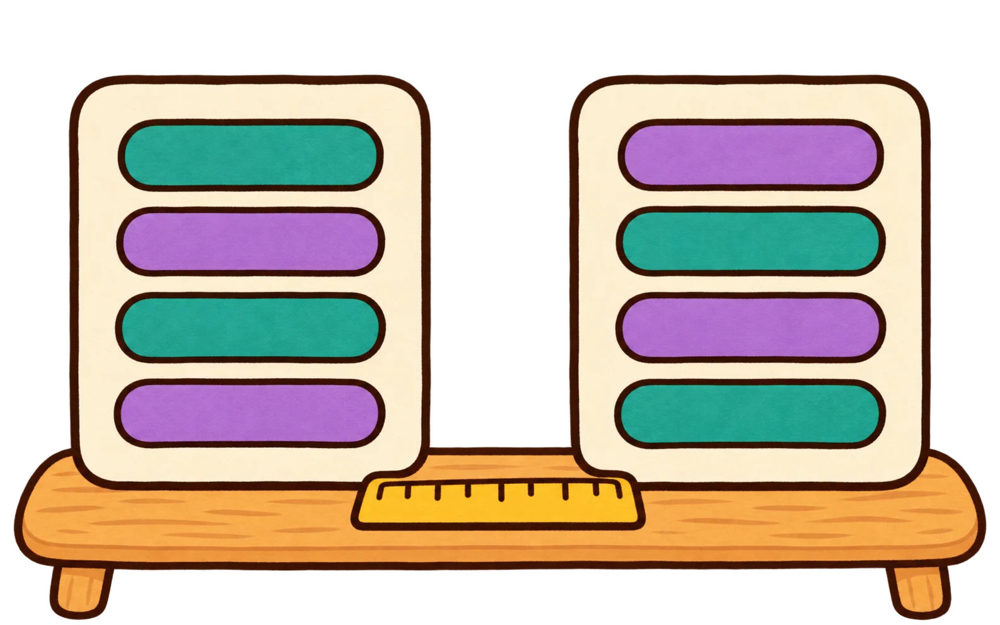

## TREC AutoJudge 2026 {#cover}

<p class="subtitle">Pairwise preferences and citation evidence</p>

<figure class="chapter-picture cover-picture"></figure>

<p class="byline">Nidhin Pattaniyil · Tanwir Zaman · Semih Yagli — NP Labs</p>

## What we will walk through {#roadmap .roadmap-slide}

<ol class="roadmap">
  <li><a href="#task"><span class="roadmap-label">The judging task</span></a></li>
  <li><a href="#workweek"><span class="roadmap-label">The four-day-workweek example</span></a></li>
  <li><a href="#pairwise-section"><span class="roadmap-label">Pairwise preferences</span></a></li>
  <li><a href="#evidence-section"><span class="roadmap-label">Coverage and citation support</span></a></li>
  <li><a href="#results-section"><span class="roadmap-label">Organizer results</span></a></li>
</ol>

<p class="caption">One example answer, followed from the judge’s input to its score.</p>

## What AutoJudge predicts {#task}

<p class="eyebrow">RAG and RAGTIME · Three judging methods</p>

```{=html}
<div class="flow task-flow" role="group" aria-label="From cited answers to a system ranking">
  <div>
    
    <strong>Cited answers</strong>
    <p>For each question, systems submit answers with citations.</p>
  </div>
  <span class="arrow" aria-hidden="true">→</span>
  <div>
    
    <strong>Score the answers</strong>
    <p>Compare answers, score coverage and citation support, or average the two scores.</p>
  </div>
  <span class="arrow" aria-hidden="true">→</span>
  <div>
    
    <strong>Rank the systems</strong>
    <p>Average each system’s scores across questions.</p>
  </div>
</div>
```

<p class="caption">The organizers compare our predicted ranking with the official ranking of each host track.</p>

::: {.notes}
AutoJudge evaluates the answer-generating systems submitted to the RAG and RAGTIME host tracks. We submitted Pairwise, Evidence and Combined for each track. Here a “system” is an answer generator being ranked. Our submission scores and the host-track official scores are different objects. Sources: notebook paper, §1, and the official track task description at https://trec-auto-judge.cs.unh.edu/.
:::

## Three ways we judged answers {#approaches}

<p class="eyebrow">GPT-6 Luna · RAG and RAGTIME</p>

```{=html}
<div class="method-body">
  <div class="examples approach-inputs">
    <article>
      <h3>Pairwise</h3>
      <p>Compare two answers in both orders. Use the votes to score each answer.</p>
    </article>
    <article>
      <h3>Evidence</h3>
      <p>Generate a reference answer and a checklist. Check what each answer covers and how well its citations support it.</p>
    </article>
    <article class="combined-approach">
      <h3>Combined</h3>
      <p>Average the two scores for each answer.</p>
      <div class="blend-weights">
        <div class="blend-term"><strong>50%</strong><span>Pairwise</span></div>
        <span aria-hidden="true">+</span>
        <div class="blend-term"><strong>50%</strong><span>Evidence</span></div>
      </div>
    </article>
  </div>
</div>
```

<p class="caption">We submitted each approach to both RAG and RAGTIME, for six runs.</p>

::: {.notes}
Pairwise and Evidence can score answers independently. The Evidence workflow generates the reference answer and checklist together from pooled cited excerpts. Coverage uses the checklist. Citation support uses each answer’s own cited evidence. Combined averages the two scores. Sources: notebook paper, §§1 and 5, and the frozen UnifiedJudge implementation.
:::

## The answer we will follow {#workweek}

<p class="eyebrow example">Illustrative example · Four-day workweek</p>

<blockquote class="prompt">How does a four-day workweek change <mark>hours and wellbeing</mark>?</blockquote>

```{=html}
<div class="example-scene">
  <figure>
    
  </figure>
  <div class="examples answer-quotes">
    <article><h3>Answer A</h3><p>Employees work 32 hours a week [1]. This reduces stress and <mark>doubles company profits</mark> [2].</p></article>
    <article><h3>Answer B</h3><p>A four-day workweek gives employees more time off.</p></article>
  </div>
</div>
```

<p class="caption">We’ll follow Answer A through preference, coverage and citation support.</p>

::: {.notes}
This is an authored example from the paper, inspired by RAGTIME 2025 topic 1033. The answers, sources, votes, and derived scores in the walkthrough are illustrative. Ask the audience which answer they prefer before asking what the second citation supports. Source: notebook paper, §§2 and 5.
:::

## Pairwise preferences {#pairwise-section .chapter}

<figure class="chapter-picture"></figure>

## Compare the two answers in both orders {#pairwise}

<p class="eyebrow example">Workweek example · Pairwise</p>

```{=html}
<div class="method-body">
  <div class="flow judge-flow">
    <div>
      <h3>Input</h3>
      <ul class="judge-inputs">
        <li>Question and length limit</li>
        <li>Two anonymous answers</li>
        <li>Citation markers</li>
      </ul>
    </div>
    <span class="arrow" aria-hidden="true">→</span>
    <div class="judge-rubric">
      <h3>GPT-6 Luna checks</h3>
      <ul class="judge-checklist">
        <li>Answers the request</li>
        <li>Includes key information</li>
        <li>Handles facts carefully</li>
        <li>Stays relevant and clear</li>
      </ul>
    </div>
    <span class="arrow" aria-hidden="true">→</span>
    <div>
      <h3>Output</h3>
      <ul class="judge-votes" role="list">
        <li>First</li>
        <li>Second</li>
        <li>Tie</li>
      </ul>
      <p>A short reason for the vote</p>
    </div>
  </div>
  <div class="split">
    <table class="evidence-table">
      <thead><tr><th scope="col">Order shown</th><th scope="col">Illustrative vote</th><th scope="col">Credit to A</th></tr></thead>
      <tbody>
        <tr><td>A, then B</td><td>First answer wins <small>Covers hours and wellbeing.</small></td><td>1</td></tr>
        <tr><td>B, then A</td><td>Tie</td><td>0.5</td></tr>
      </tbody>
    </table>
    <div class="equation">
      <span class="step-label">A’s credit against B</span>
      <strong>0.75</strong>
      <span class="arithmetic">(1 + 0.5) / 2</span>
    </div>
  </div>
</div>
```

<p class="caption">Swap positions to reduce order bias. Map each vote back to the original answers and average the credits (win 1, tie 0.5, loss 0).</p>

::: {.notes}
This is the blind Pairwise prompt, so the model receives no source excerpts. The two votes are illustrative. The pair credit goes into a separate fit for this question. Source: notebook paper, §2, and frozen judges/generic/pairwise.py.
:::

## From pairwise judgments to a score {#pairwise-overview}

<p class="eyebrow example">Workweek example · One question with 20 answers</p>

```{=html}
<div class="method-body">
  <div class="flow method-steps">
    <div>
      <span class="step-label">Choose pairs</span>
      <strong>100 answer pairs</strong>
      <p>Give each answer ten opponents. Count each pair once.</p>
    </div>
    <span class="arrow" aria-hidden="true">→</span>
    <div>
      <span class="step-label">Vote in both orders</span>
      <strong>200 judgments</strong>
      <p>Show each pair twice, swapping which answer comes first.</p>
    </div>
    <span class="arrow" aria-hidden="true">→</span>
    <div>
      <span class="step-label">Turn votes into scores</span>
      <strong>Bradley–Terry</strong>
      <p>Fit a rating for each answer and estimate its win chance against every opponent.</p>
    </div>
  </div>
  <p class="takeaway"><strong>Answer A scores 0.60.</strong> We average its estimated win chances against the other 19 answers.</p>
</div>
```

<p class="caption">The full runs scheduled 98,770 ordered judgments on RAG and 50,470 on RAGTIME.</p>

::: {.notes}
In the example, 20 answers × 10 opponents ÷ 2 gives 100 unique pairs. Two presentation orders per pair give 200 judgments. Bradley–Terry uses the observed credits to predict win chances against all opponents, including the nine without a direct vote for A. The appendix shows the schedule, the worked 0.60 example, and the fit. The full-track counts come from the ten-opponent schedule over the complete submitted grids: 119 questions × 83 answers × 10 on RAG and 103 × 49 × 10 on RAGTIME. These counts are scheduled presentation-order judgments. The execution ledger tracks provider calls separately. The all-pairs case averages observed credits directly. Sources are the notebook paper, §2, and the submission history and frozen Pairwise artifacts.
:::

## Coverage and citation support {#evidence-section .chapter}

<figure class="chapter-picture"></figure>

## GPT-6 Luna generates a reference answer and checklist {#coverage}

<p class="eyebrow example">Workweek example · Two outputs from one request</p>

```{=html}
<div class="method-body">
  <div class="flow task-flow checklist-flow" role="group" aria-label="Use pooled cited evidence to generate a reference answer and shared checklist together">
    <div><strong>Question + excerpts</strong><p>Pool cited evidence across answers.</p></div>
    <span class="arrow" aria-hidden="true">→</span>
    <div><strong>GPT-6 Luna</strong><p>Distills the key points.</p></div>
    <span class="arrow" aria-hidden="true">→</span>
    <div><strong>Reference answer + checklist</strong></div>
  </div>
  <div class="record-panels reference-outputs">
    <article class="record-panel">
      <h3>Reference answer</h3>
      <p class="record-field"><b>Saved with the run</b></p>
      <p>“Weekly hours can drop to 32 [1], and workers may report less stress [2].”</p>
    </article>
    <article class="record-panel">
      <h3>Checklist used to grade each answer</h3>
      <table class="evidence-table checklist-table">
        <thead><tr><th scope="col">Required item</th><th scope="col">What earns credit</th></tr></thead>
        <tbody>
          <tr><th scope="row"><code>I1</code> · Hours</th><td>Explains the change in weekly hours <small>Example · Four eight-hour days (32 hours)</small></td></tr>
          <tr><th scope="row"><code>I2</code> · Wellbeing</th><td>Describes a change in wellbeing <small>Example · Reduced stress</small></td></tr>
        </tbody>
      </table>
    </article>
  </div>
</div>
```

<p class="caption">Illustrative outputs. RAG coverage averages the required factual and request items (such as format). Covered earns 1, partial 0.5, and missing 0. Optional items carry no weight.</p>

::: {.notes}
One model request asks for both outputs. The pipeline validates the response and can retry it. The reference prose is saved with the run. The later coverage call receives the question, each system answer and the frozen checklist with its acceptable alternatives. The citation-support score uses the system answer’s own sources. The reference prose and checklist on this slide are authored examples. The two shown items are factual. Under a tight context budget, the model can use deduplicated, validated claims with source links. Sources: notebook paper, §§3–5, and frozen judges/generic/unified.py and shared_semantics.py.
:::

## Judge coverage and citation support separately {#citations}

<p class="eyebrow example">Workweek example · Records for Answer A</p>

```{=html}
<div class="method-body">
  <div class="record-panels">
    <article class="record-panel">
      <h3>Coverage</h3>
      <p class="record-field"><b>Input</b> Question + Answer A + frozen checklist</p>
      <p class="record-field"><b>Record</b> Each item’s grade and just the answer sentences that justify it.</p>
      <table class="evidence-table coverage-records">
        <thead><tr><th scope="col">Item</th><th scope="col">Grade</th><th scope="col">Where in Answer A</th></tr></thead>
        <tbody>
          <tr><th scope="row"><code>I1</code><small>Working hours</small></th><td>Covered</td><td><code>C1</code><small>“32 hours a week”</small></td></tr>
          <tr><th scope="row"><code>I2</code><small>Wellbeing</small></th><td>Covered</td><td><code>C2</code><small>“reduces stress”</small></td></tr>
        </tbody>
      </table>
    </article>
    <article class="record-panel">
      <h3>Citation support</h3>
      <p class="record-field"><b>Input</b> Answer A + its own cited sources</p>
      <p class="record-field"><b>Record</b> How well each citation supports its sentence, with the relevant excerpt.</p>
      <table class="evidence-table support-table">
        <thead><tr><th scope="col">Pair</th><th scope="col">Supported portion</th><th scope="col">Credit</th></tr></thead>
        <tbody>
          <tr><th scope="row"><code>C1</code> [1]</th><td>32 hours</td><td>1 <small>Full</small></td></tr>
          <tr><th scope="row"><code>C2</code> [2]</th><td><strong class="supported">Less stress</strong> <small>Doubled profits unestablished.</small></td><td>0.5 <small>Partial</small></td></tr>
        </tbody>
      </table>
    </article>
  </div>
  <p class="takeaway"><strong>(1 + 0.5) / 2 = 0.75</strong> for all three partial-credit citation measures here, with one citation per segment.</p>
</div>
```

<p class="caption">C1 and C2 label sentences in Answer A. Full credit can require several sentences. We use their labels to find the citation evidence.</p>

::: {.notes}
The coverage call does not receive source text or citation labels. C1 and C2 label the original segments, which are sentences in this example. The coverage judge selects the smallest set that justifies each grade. Full credit requires that the selected sentences jointly satisfy the requirement or an accepted alternative. In this example, C1 says “32 hours [1]” and C2 says “Less stress and double profits [2].” Those are authored example segments, and the support column paraphrases the illustrative sources. Source: notebook paper, §§3–5, and frozen judges/generic/coverage_join.py.
:::

## How Answer A earns its grade {#answer-grade}

<p class="eyebrow example">Illustrative workweek example</p>

```{=html}
<div class="method-body">
  <article class="record-panel">
    <h3>Answer A</h3>
    <p>Employees work <mark>32 hours a week</mark> [1]. This <mark>reduces stress</mark> and doubles company profits [2].</p>
  </article>
  <table class="evidence-table">
    <thead><tr><th scope="col">Required checklist item</th><th scope="col">Where Answer A covers it</th><th scope="col">Grade</th></tr></thead>
    <tbody>
      <tr><th scope="row"><code>I1</code> · Explain the change in weekly hours</th><td>“32 hours a week”</td><td>Covered · <strong>1</strong></td></tr>
      <tr><th scope="row"><code>I2</code> · Describe a change in wellbeing</th><td>“reduces stress”</td><td>Covered · <strong>1</strong></td></tr>
    </tbody>
  </table>
  <div class="examples score-examples">
    <article>
      <h3>Checklist coverage</h3>
      <p class="calculation">(1 + 1) / 2 <strong>= 1.00</strong></p>
    </article>
    <article>
      <h3>Mean citation support</h3>
      <p class="calculation">(1 + 0.5) / 2 <strong>= 0.75</strong></p>
    </article>
  </div>
</div>
```

<p class="caption">Citation [1] earns <strong>1</strong> for fully supporting the hours sentence.</p>
<p class="caption">Citation [2] earns <strong>0.5 for partial support</strong> because it supports only the reduced stress claim. Doubled profits remain unverified.</p>

::: {.notes}
This returns to Answer A and the same two required checklist items from the earlier workweek slides. The checklist judge marks both covered. The citation judge gives [1] full credit and [2] partial credit because [2] supports only the stress portion of its sentence. With one citation per sentence, 0.75 is shared by the three partial-credit citation measures. Both factual items also earn full grounded coverage because their required portions are supported. See the appendix for the segment-level join and the track-specific Evidence and Combined calculations. All wording and judgments are illustrative, based on the notebook paper, §§3–5.
:::

## Results {#results-section .chapter}

<figure class="chapter-picture"></figure>

## Our best score on each track {#results}

<p class="eyebrow">Organizer results · Rank agreement (tauap_b)</p>

```{=html}
<div class="method-body">
  <div class="examples score-examples headline-results">
    <article>
      <h3>RAG</h3>
      <p class="headline-score"><strong>0.573</strong></p>
      <p><b>Request coverage</b></p>
      <p>Ranked systems by how much of the request their answers covered.</p>
    </article>
    <article>
      <h3>RAGTIME</h3>
      <p class="headline-score"><strong>0.585</strong></p>
      <p><b>Full sentence support</b></p>
      <p>Ranked systems by how often the first citation fully supported an answer segment.</p>
      <p class="top-five">Top five overall on RAGTIME</p>
    </article>
  </div>
</div>
```

<p class="caption">We submitted answer scores for each rule. The organizer ranked systems using those scores and reported agreement with each track’s official ranking.</p>

::: {.notes}
RAG’s best reported measure was RAG_REQUEST_COVERAGE_PROXY, tauap_b 0.573318. RAGTIME’s was RAGTIME_SENTENCE_SUPPORT_PROXY, tauap_b 0.584562. Both measures were reported by ntp-combined-v1. The organizer used the latter measure to represent that run tag in the RAGTIME overall top five. The detailed output scores and evaluation protocol are in the appendix. Source: November 13 organizer package.
:::

## How our three approaches scored {#approach-results}

<p class="eyebrow">Organizer results · Rank agreement (tauap_b)</p>

```{=html}
<div class="method-body">
  <p class="method-input"><strong>We</strong> scored answers in <code>ntp-combined-v1</code>. <strong>The organizer</strong> compared system rankings.</p>
  <table class="evidence-table approach-results-table">
    <thead><tr><th scope="col">Judging approach</th><th scope="col">RAG <small>Human preferences</small></th><th scope="col">RAGTIME <small>Mostly human F1</small></th></tr></thead>
    <tbody>
      <tr><th scope="row">Pairwise</th><td><strong>0.506</strong></td><td>−0.010</td></tr>
      <tr><th scope="row">Evidence</th><td>0.050</td><td><strong>0.553</strong></td></tr>
      <tr><th scope="row">Combined <small>50% Pairwise + 50% Evidence</small></th><td>0.496</td><td>0.253</td></tr>
    </tbody>
  </table>
  <div class="rank-example">
    <h3>Illustrative RAG example</h3>
    <p class="method-input">Mean system scores across questions. Evidence averages coverage, citation precision, and recall.</p>
    <table class="evidence-table rank-example-table" aria-label="Illustrative coverage and Evidence rankings for two systems">
      <thead><tr><th scope="col">System</th><th scope="col">Rank by coverage only</th><th scope="col">Rank by Evidence</th></tr></thead>
      <tbody>
        <tr><th scope="row">A</th><td><strong>1st</strong> · 0.90</td><td><strong>2nd</strong> · 0.65 <small>(0.90 + 0.45 + 0.60) / 3</small></td></tr>
        <tr><th scope="row">B</th><td><strong>2nd</strong> · 0.60</td><td><strong>1st</strong> · 0.75 <small>(0.60 + 0.75 + 0.90) / 3</small></td></tr>
      </tbody>
    </table>
  </div>
</div>
```

<p class="caption">On RAG, request coverage scored 0.573 in rank agreement. Both citation checks scored below zero. <a href="https://github.com/npatta01/trec-auto-judge-2026/blob/main/docs/organizer-results-2026-11-13.md">Organizer score tables</a></p>

::: {.notes}
The organizer reports these rank-agreement scores for ntp-combined-v1. On RAG and RAGTIME respectively, Pairwise scored 0.505701 and −0.009917, Evidence scored 0.050418 and 0.553361, and Combined scored 0.496304 and 0.252738. The standalone Pairwise run has the same reported values.

RAG Evidence gives equal weight to request coverage, citation precision, and citation recall per answer. The organizer’s rank agreements for those three rules alone were 0.573318, −0.192315, and −0.169184. The illustrative example shows how two weaker citation scores can move a high-coverage system down. To get the 0.050 agreement score, the organizer ranks systems by their mean Evidence scores and compares that ranking with the official ranking.

RAGTIME Pairwise had little net agreement with the official F1 ranking. Pairwise sees the answers and citation markers. RAGTIME’s official assessment checks support in the cited sources. The organizer score tables contain rank agreement for each measure.
:::

## Conclusion {#conclusion .closing}

<p class="eyebrow">Three judging approaches and our best scores</p>

```{=html}
<div class="method-body">
  <ol class="closing-methods">
    <li><strong>Pairwise</strong> Compare answers head to head.</li>
    <li><strong>Evidence</strong> Check coverage and citation support.</li>
    <li><strong>Combined</strong> Give the two scores equal weight.</li>
  </ol>
  <div>
    <p class="table-label">Our best rank agreement (tauap_b)</p>
    <div class="examples score-examples conclusion-scores">
      <article><h3>RAG</h3><p><strong>0.573</strong> · Request coverage</p></article>
      <article><h3>RAGTIME</h3><p><strong>0.585</strong> · Full sentence support</p><p class="top-five">Top five overall</p></article>
    </div>
  </div>
  <p class="method-input">On both tracks, the best individual measure had higher agreement than the equal-weight blend.</p>
</div>
```

<p class="source-links"><a href="https://github.com/npatta01/trec-auto-judge-2026/blob/986980322f1602442739db5fc318e3d6bf861c8d/docs/paper/autojudge2026.pdf">Notebook paper</a> <span aria-hidden="true">·</span> <a href="https://github.com/npatta01/trec-auto-judge-2026/blob/main/docs/organizer-results-2026-11-13.md">Organizer score tables</a></p>

::: {.notes}
Scores are rounded from 0.573318 (RAG request coverage) and 0.584562 (RAGTIME full-only sentence support). Both were emitted under ntp-combined-v1. The overall top-five marker applies to the run tag as represented by its best measure. Rank agreement is measured on the organizer’s annotated topics and official system sets. Sources: notebook paper, §5, and November 13 organizer package.
:::

## Appendix {#appendix-section .appendix-divider}

<p class="intro">Pairwise rating fit, worked scoring examples, and detailed results</p>

## Select five neighbors on each side {#pairwise-fit}

<p class="eyebrow appendix">Appendix · Pairwise comparison schedule</p>

```{=html}
<div class="method-body">
  <p class="method-input"><strong>Per question</strong> Sort the answers by a fixed hash, then join the ends into a ring.</p>
  <div class="ring" role="group" aria-label="A's five preceding and five following neighbors in the hash-ordered ring">
    <span aria-hidden="true">…</span><span>−5</span><span>−4</span><span>−3</span><span>−2</span><span>−1</span><strong>A</strong><span>+1</span><span>+2</span><span>+3</span><span>+4</span><span>+5</span><span aria-hidden="true">…</span>
  </div>
  <p class="caption ring-caption">The ring shown unrolled. Numbers are offsets from A.</p>
  <div class="flow method-steps">
    <div><span class="step-label">Example question</span><strong>20 answers</strong><p>10 neighbors per answer</p></div>
    <span class="arrow" aria-hidden="true">→</span>
    <div><span class="step-label">Count each pair once</span><strong>100 unique pairs</strong><p>20 × 10 ÷ 2</p></div>
    <span class="arrow" aria-hidden="true">→</span>
    <div><span class="step-label">Judge both orders</span><strong>200 ordered judgments</strong><p>100 pairs × 2 orders</p></div>
  </div>
</div>
```

<p class="caption">Use ten neighbors with at least eleven answers. Below eleven, compare every available pair.</p>

::: {.notes}
The schedule is reproducible per question. The shared edges connect the comparison graph, so the next step can estimate relative strengths across all answers. The 20-answer count illustrates the schedule. Source: notebook paper, §2, and comparison_schedule in the frozen implementation.
:::

## From pairwise votes to an answer score {#pairwise-score}

<p class="eyebrow appendix">Appendix · Workweek example · 20 answers</p>

```{=html}
<div class="method-body">
  <div class="flow method-steps">
    <div>
      <span class="step-label">Judge 10 of A’s 19 pairs</span>
      <strong>A gets 0.75 against B</strong>
      <p>A wins one presentation and ties the other. (1 + 0.5) / 2 = 0.75.</p>
    </div>
    <span class="arrow" aria-hidden="true">→</span>
    <div>
      <span class="step-label">Fit Bradley–Terry</span>
      <strong>One rating per answer</strong>
      <p>Fit the ratings to the credits from all 100 judged pairs for this question.</p>
    </div>
    <span class="arrow" aria-hidden="true">→</span>
    <div>
      <span class="step-label">Predict every matchup</span>
      <strong>Rating gap → win chance</strong>
      <p>Apply a logistic curve to A’s rating minus the opponent’s. A +1 gap gives a win chance of 0.73.</p>
    </div>
  </div>
  <div class="split">
    <table class="evidence-table">
      <thead><tr><th scope="col">A’s opponents</th><th scope="col">Example win chances</th><th scope="col">Mean</th></tr></thead>
      <tbody>
        <tr><th scope="row">10 with direct votes</th><td>5 at 0.65, 5 at 0.73</td><td><strong>0.69</strong></td></tr>
        <tr><th scope="row">9 without direct votes</th><td>4 at 0.40, 1 at 0.50, 4 at 0.60</td><td><strong>0.50</strong></td></tr>
      </tbody>
    </table>
    <div class="equation">
      <span class="step-label">A’s illustrative Pairwise score</span>
      <strong>0.60</strong>
      <span class="arithmetic">(10 × 0.69 + 9 × 0.50) / 19</span>
    </div>
  </div>
</div>
```

<p class="caption">The same curve applies to every opponent. Equal ratings give a 0.50 win chance. The next slide gives the formula.</p>

::: {.notes}
In this 20-answer example, the 0.75 is one observed pair credit. A’s rating is informed by its ten observed pairs and by the other observed pairs that connect those opponents. A’s win chances come from the fitted ratings, including for opponents A never faced. The example assumes A’s rating gaps are +0.6 and +1.0 for five judged opponents each, and −0.4, 0, and +0.4 for four, one, and four unjudged opponents. Applying the logistic function to each gap gives the rounded probabilities in the table. The average across all 19 gives 0.60, which is the Pairwise score used in the Combined example. Source is the notebook paper, §2, and aggregate_decisions at the submitted Pairwise revision.
:::

## How the Bradley–Terry rating fit works {#bradley-terry}

<p class="eyebrow appendix">Appendix · Pairwise rating fit</p>

```{=html}
<div class="method-body">
  <div class="flow method-steps">
    <div><span class="step-label">Observe</span><strong>A earns 0.75 vs B</strong><p>One of the pairs we judged</p></div>
    <span class="arrow" aria-hidden="true">→</span>
    <div><span class="step-label">Fit Bradley–Terry</span><strong>One rating per answer</strong><p>Fit ratings jointly to match observed credits. The L2 penalty limits extreme ratings.</p></div>
    <span class="arrow" aria-hidden="true">→</span>
    <div><span class="step-label">Predict</span><strong>A’s win chance vs each opponent</strong><p>Use the ratings for pairs with no direct vote, too.</p></div>
  </div>
  <div class="split">
    <table class="evidence-table">
      <thead><tr><th scope="col">A’s 19 opponents</th><th scope="col">Mean fitted win chance</th></tr></thead>
      <tbody>
        <tr><th scope="row">10 compared with A</th><td>0.69</td></tr>
        <tr><th scope="row">9 with no direct vote</th><td>0.50</td></tr>
      </tbody>
    </table>
    <div class="equation">
      <span class="step-label">A’s illustrative Pairwise score</span>
      <strong>0.60</strong>
      <span class="arithmetic">(10 × 0.69 + 9 × 0.50) / 19</span>
    </div>
  </div>
</div>
```

<p class="caption"><strong>Fit details</strong> Minimize logistic loss with an L2 penalty. P(A beats B) = σ(<var>s<sub>A</sub> − s<sub>B</sub></var>), where σ is the logistic function. A one-point rating gap gives a win chance of about 0.73. With every pair judged, average the observed credits directly.</p>

::: {.notes}
The optimizer fits a regularized logistic loss to the observed pair credits. For a cohort where all opponents were judged, the implementation uses the mean observed credit. Talk track: the 0.75 is one head-to-head result. The model fits one rating per answer from all observed pairs and predicts the chance of winning even for pairs we skipped. In this illustration we had 20 answers, so A has 10 compared opponents and 9 without a direct vote. Suppose the fitted probabilities average 0.69 and 0.50 in those groups. The mean over all 19 is 0.60, which is the illustrative Pairwise input to Combined. The optimizer uses observed fractional pair credits as logistic targets and minimizes their summed loss plus 0.05 × the sum of squared ratings. L-BFGS-B finds one rating per answer. Equal ratings give a 0.5 predicted win chance. Source: notebook paper, §§2 and 5, and aggregate_decisions in the frozen implementation.
:::

## What the RAG and RAGTIME metrics measure {#metric-context}

<p class="eyebrow appendix">Appendix · Host-track criteria and our Evidence measures</p>

```{=html}
<div class="method-body">
  <div class="record-panels even-panels metric-panels">
    <article class="record-panel">
      <h3>RAG</h3>
      <p class="record-field"><b>Official criteria</b> A nugget rubric for each request, plus weighted citation precision and recall.</p>
      <table class="evidence-table">
        <thead><tr><th scope="col">Our proxy</th><th scope="col">What it checks</th></tr></thead>
        <tbody>
          <tr><th scope="row">Request coverage</th><td>Does the answer meet the request?</td></tr>
          <tr><th scope="row">Citation precision</th><td>Do the supplied citations support their segments?</td></tr>
          <tr><th scope="row">Citation recall</th><td>How much of the answer has citation support?</td></tr>
        </tbody>
      </table>
    </article>
    <article class="record-panel">
      <h3>RAGTIME</h3>
      <p class="record-field"><b>Official criteria</b> Correctly cited nuggets and citation precision on eligible report sentences. The main measure uses the top-priority citation.</p>
      <table class="evidence-table">
        <thead><tr><th scope="col">Our proxy</th><th scope="col">What it checks</th></tr></thead>
        <tbody>
          <tr><th scope="row">Grounded factual coverage</th><td>Are the requested facts present and supported by their own citations?</td></tr>
          <tr><th scope="row">Top-citation support</th><td>Does the system’s first-choice citation support each segment?</td></tr>
        </tbody>
      </table>
    </article>
  </div>
  <p class="method-input"><strong>Nuggets</strong> Key facts or requirements that an answer or report should cover.</p>
</div>
```

<p class="source-links"><a href="https://github.com/TREC-RAG/trec-rag-skills/blob/main/skills/trec-rag-2026-track-guidelines/references/rag-task.md#evaluation">RAG official guidelines</a> <span aria-hidden="true">·</span> <a href="https://docs.google.com/document/d/1XqypNTHxIdazxfnUebrp-EsUuGNhodhQGrJIDnYGaB4/edit?usp=sharing">RAGTIME official guidelines</a></p>

::: {.notes}
Citation precision is about the supplied citations. Adding a weak citation can lower it. Citation recall is about answer segments; leaving one unsupported lowers it. RAG evaluates both with weights. Our RAG precision proxy averages unit-weighted segment–citation credit, and our recall proxy uses the best single citation with an available support label. RAGTIME asks for correctly cited nuggets and scores eligible report sentences using the top-priority citation in the main measure. Our grounding and top-citation estimates reuse the same within-answer support records. Sources: RAG 2026 Evaluation, RAGTIME 2026 Metrics and Appendix, and notebook paper §4.
:::

## Two citations can produce three different scores {#citation-order}

<p class="eyebrow appendix">Appendix · Illustrative example · One segment, two citations</p>

```{=html}
<div class="method-body">
  <div class="examples example-citations">
    <article><h3>First citation</h3><p>Unestablished <strong>0</strong></p></article>
    <article><h3>Second citation</h3><p>Full support <strong>1</strong></p></article>
  </div>
  <table class="evidence-table citation-scores">
    <thead><tr><th scope="col">Measure</th><th scope="col">How credit is aggregated</th><th scope="col">Example</th></tr></thead>
    <tbody>
      <tr><th scope="row">RAG precision</th><td>Mean credit across every segment–citation pair</td><td class="calculation">(0 + 1) / 2 <strong>= 0.50</strong></td></tr>
      <tr><th scope="row">RAG recall</th><td>Best single citation per segment, then mean</td><td class="calculation">max(0, 1) <strong>= 1</strong></td></tr>
      <tr><th scope="row">RAGTIME support</th><td>First citation in the system’s order per segment, then mean</td><td class="calculation">first(0, 1) <strong>= 0</strong></td></tr>
    </tbody>
  </table>
  <p class="method-input"><strong>Why best or first</strong> We label each citation on its own, so our RAG recall proxy takes the strongest label. RAGTIME uses the system’s first choice.</p>
</div>
```

<p class="caption">Support credit is full 1 · partial 0.5 · unestablished 0. Uncited segments contribute zero to RAG recall and RAGTIME top-citation support.</p>

::: {.notes}
RAG recall uses the best single citation as our approximation. RAGTIME uses the system’s citation priority. The three numbers are the output for this one-segment example. Support credit is unit-weighted, and partial citations are not added together for recall. Source: notebook paper, §4, and aggregate in the frozen implementation.
:::

## Join the records by answer segment {#grounded-coverage}

<p class="eyebrow appendix">Appendix · Workweek example</p>

```{=html}
<div class="method-body">
  <div class="flow method-steps" aria-label="Trace wellbeing from checklist item I2 through segment C2 to citation 2">
    <div><span class="step-label">Coverage link</span><strong>I2 → C2</strong><p>Wellbeing through reduced stress</p><p>C2 also claims doubled profits.</p></div>
    <span class="arrow" aria-hidden="true">→</span>
    <div><span class="step-label">Check the excerpt</span><strong>C2 + [2]</strong><p>“Workers reported less stress.”</p><p>Illustrative retained excerpt</p></div>
    <span class="arrow" aria-hidden="true">→</span>
    <div><span class="step-label">Grounded item</span><strong>I2 earns 1</strong><p>Reduced stress satisfies wellbeing.</p><p>C2 keeps its 0.5 citation credit.</p></div>
  </div>
  <table class="evidence-table measure-table">
    <thead><tr><th scope="col">Measure</th><th scope="col">Why both items count</th><th scope="col">Credit</th></tr></thead>
    <tbody>
      <tr><th scope="row">RAG coverage</th><td>A addresses both required items.</td><td><strong>2/2</strong></td></tr>
      <tr><th scope="row">RAGTIME grounded factual coverage</th><td>[1] supports hours. [2] supports reduced stress.</td><td><strong>2/2</strong></td></tr>
    </tbody>
  </table>
</div>
```

<p class="caption">For unresolved factual items, check the linked segments’ retained excerpts when available. Partial grounding can earn 0.5 in RAGTIME Evidence.</p>

::: {.notes}
The join uses the segment IDs selected by coverage. The targeted follow-up checks the literal supported portion from within-answer cited excerpts. It cannot borrow excerpts from the pooled checklist sources or award a full item for a partly covered route. Source: notebook paper, §§3 and 5, and partial_packet, merge_partial_links, and checklist_scores in the frozen implementation.
:::

## Score coverage and citations, then combine {#track-scores}

<p class="eyebrow appendix">Appendix · Workweek example · Answer A</p>

```{=html}
<div class="method-body">
  <p class="method-input"><strong>Pairwise = 0.60</strong> Illustrative fitted mean for Answer A</p>
  <div class="examples score-examples track-formulas">
    <article>
      <h3>RAG</h3>
      <p class="component">Request coverage <strong>1.00</strong></p>
      <p class="component">Citation precision <strong>0.75</strong></p>
      <p class="component">Citation recall <strong>0.75</strong></p>
      <p class="calculation"><b>Evidence</b><br>(1 + 0.75 + 0.75) / 3 <strong>≈ 0.833</strong></p>
      <p class="calculation"><b>Combined</b><br>(0.60 + 0.833…) / 2 <strong>≈ 0.717</strong></p>
    </article>
    <article>
      <h3>RAGTIME</h3>
      <p class="component">Grounded factual coverage <strong>1.00</strong></p>
      <p class="component">Top-citation support <strong>0.75</strong></p>
      <p class="calculation"><b>Evidence</b><br>(1 + 0.75) / 2 <strong>= 0.875</strong></p>
      <p class="calculation"><b>Combined</b><br>(0.60 + 0.875) / 2 <strong>≈ 0.738</strong></p>
    </article>
  </div>
  <p class="takeaway"><strong>Combined = ½ Pairwise + ½ Evidence</strong></p>
</div>
```

<p class="caption">Score each answer first. The system score is the mean across its questions.</p>

::: {.notes}
The example has one citation per segment, so the partial-credit citation inputs coincide. In RAGTIME, the top-citation input to Evidence gives half credit for partial support. The organizer separately evaluated the full-only sentence-support measure. Source: notebook paper, §§3–5, and EVIDENCE_COMPONENTS in the frozen implementation.
:::

## What the organizers measured {#meta-evaluation}

<p class="eyebrow appendix">Appendix · Organizer evaluation · November 13, 2026</p>

```{=html}
<div class="method-body">
  <div class="flow method-steps">
    <div><span class="step-label">Select</span><strong>Manually annotated topics</strong></div>
    <span class="arrow" aria-hidden="true">→</span>
    <div><span class="step-label">Aggregate</span><strong>Mean judge score per system</strong></div>
    <span class="arrow" aria-hidden="true">→</span>
    <div><span class="step-label">Compare</span><strong>Official leaderboard ranks</strong></div>
  </div>
  <table class="evidence-table track-table">
    <thead><tr><th scope="col">Stage</th><th scope="col">RAG</th><th scope="col">RAGTIME</th></tr></thead>
    <tbody>
      <tr><th scope="row">Judged inputs</th><td>119 questions · 83 systems</td><td>103 questions · 49 systems</td></tr>
      <tr><th scope="row">Meta-evaluation</th><td>42 annotated topics · 41 systems</td><td>17 annotated topics · 27 systems</td></tr>
      <tr><th scope="row">Official target</th><td><code>bt_score</code><small>Bradley–Terry rating from human side-by-side preferences</small></td><td><code>f1_llmfilled</code><small>F1 from the mostly human assessment</small></td></tr>
    </tbody>
  </table>
  <p class="method-input"><strong>Missing score</strong> Assign 0 to any official system without a judge score before comparing ranks.</p>
</div>
```

<p class="caption"><code>tauap_b</code> is tie-aware AP rank correlation. It gives more weight to disagreements near the top. A value of 1 means full agreement.</p>

::: {.notes}
The manually annotated topic sets come from the organizer’s November 13 package. The full judged input sizes come from the notebook paper, §1. They describe different stages of evaluation.
:::

## RAG rank agreement by scoring rule {#evidence-results}

<p class="eyebrow appendix">Appendix · 10 rankings · Human preference ranking · tauap_b</p>

```{=html}
<div class="method-body">
  <p class="method-input"><strong>We</strong> scored the answers for each rule. <strong>The organizer</strong> compared the resulting system ranking with the official one.</p>
  <table class="evidence-table complete-scores">
    <thead><tr><th scope="col">Our scoring rule</th><th scope="col">Organizer score</th></tr></thead>
    <tbody>
      <tr><th scope="row">Request coverage alone</th><td><strong>0.573318</strong></td></tr>
      <tr><th scope="row">Pairwise votes</th><td>0.505701</td></tr>
      <tr><th scope="row">Combined (Pairwise + Evidence)</th><td>0.496304</td></tr>
      <tr><th scope="row">Grounded factual coverage (partial credit)</th><td>0.433537</td></tr>
      <tr><th scope="row">Evidence composite</th><td>0.050418</td></tr>
      <tr><th scope="row">Grounded checklist recall (full credit only)</th><td>0.009977</td></tr>
      <tr><th scope="row">Citation recall (partial credit)</th><td>−0.169184</td></tr>
      <tr><th scope="row">Citation precision (partial credit)</th><td>−0.192315</td></tr>
      <tr><th scope="row">Citation recall (full credit only, unweighted)</th><td>−0.201422</td></tr>
      <tr><th scope="row">Citation precision (full credit only, unweighted)</th><td>−0.202130</td></tr>
    </tbody>
  </table>
</div>
```

<p class="caption">Our <code>ntp-combined-v1</code> run reported these rankings. Standalone Pairwise also scored 0.505701. <a href="https://github.com/npatta01/trec-auto-judge-2026/blob/main/docs/organizer-results/2026-11-13/rag26-scores.tsv">Organizer score table</a></p>

::: {.notes}
All 10 distinct measures reported by the organizer for GPT-6 Luna on this track. The separate standalone Pairwise row has the same value. For example, ranking the systems using request coverage alone gave 0.573318 agreement with the human preference ranking. Each number is tauap_b against the host track’s official ranking. The Evidence composite uses request coverage and the two partial-credit citation measures. The full-credit citation rows use unit weights and include all segments or cited pairs. Grounded checklist recall requires full grounding for a required factual item.
:::

## RAGTIME rank agreement by scoring rule {#ragtime-measures}

<p class="eyebrow appendix">Appendix · 7 rankings · Official F1 from mostly human assessments · tauap_b</p>

```{=html}
<div class="method-body">
  <p class="method-input"><strong>We</strong> scored the answers for each rule. <strong>The organizer</strong> compared the resulting system ranking with the official one.</p>
  <table class="evidence-table complete-scores">
    <thead><tr><th scope="col">Our scoring rule</th><th scope="col">Organizer score</th></tr></thead>
    <tbody>
      <tr><th scope="row">Sentence support from the first citation (full credit only)</th><td><strong>0.584562</strong></td></tr>
      <tr><th scope="row">Sentence support from the first citation (partial credit)</th><td>0.558222</td></tr>
      <tr><th scope="row">Evidence composite</th><td>0.553361</td></tr>
      <tr><th scope="row">Grounded nugget recall estimate (full credit only)</th><td>0.539442</td></tr>
      <tr><th scope="row">Grounded factual coverage (partial credit)</th><td>0.379872</td></tr>
      <tr><th scope="row">Combined (Pairwise + Evidence)</th><td>0.252738</td></tr>
      <tr><th scope="row">Pairwise votes</th><td>−0.009917</td></tr>
    </tbody>
  </table>
  <p class="method-input"><strong>Full credit only</strong> We count the fraction of an answer’s segments fully supported by their first citation.</p>
</div>
```

<p class="caption">Our <code>ntp-combined-v1</code> run reported these rankings. Standalone Pairwise also scored −0.009917. <a href="https://github.com/npatta01/trec-auto-judge-2026/blob/main/docs/organizer-results/2026-11-13/ragtime26-scores.tsv">Organizer score table</a></p>

::: {.notes}
All 7 distinct measures reported by the organizer for GPT-6 Luna on this track. The separate standalone Pairwise row has the same value. Each number is tauap_b against the host track’s official ranking. The full-credit support score measures the fraction of all segments fully supported by the first citation. The partial-credit support score uses substantive segments and can give 0.5. Evidence averages the two partial-credit scores for support and grounded factual coverage. Full-credit support represents the Combined run in the overall top five.
:::

## Detailed scores by judging measure {#result-details}

<p class="eyebrow appendix">Appendix · Organizer results</p>

```{=html}
<div class="result-grid">
  <div class="result-panel" role="group" aria-label="RAG results">
    <h3><span>RAG</span></h3>
    <ol class="scores">
      <li class="best"><div class="score-label"><span>Request coverage</span><strong>0.573318</strong></div><div class="bar-track" aria-hidden="true"><i style="--value:0.573318"></i></div></li>
      <li><div class="score-label"><span>Pairwise</span><strong>0.505701</strong></div><div class="bar-track" aria-hidden="true"><i style="--value:0.505701"></i></div></li>
      <li><div class="score-label"><span>Combined average</span><strong>0.496304</strong></div><div class="bar-track" aria-hidden="true"><i style="--value:0.496304"></i></div></li>
      <li><div class="score-label"><span>Coverage and citation score</span><strong>0.050418</strong></div><div class="bar-track" aria-hidden="true"><i style="--value:0.050418"></i></div></li>
    </ol>
    <div class="scale" aria-hidden="true"><span>−0.1</span><span>0</span><span>0.3</span><span>0.6</span></div>
  </div>
  <div class="result-panel time-panel" role="group" aria-label="RAGTIME results">
    <h3><span>RAGTIME</span> <span class="result-marker">Top five overall</span></h3>
    <ol class="scores">
      <li class="best"><div class="score-label"><span>Sentence support (full-only)</span><strong>0.584562</strong></div><div class="bar-track" aria-hidden="true"><i style="--value:0.584562"></i></div></li>
      <li><div class="score-label"><span>Coverage and citation score</span><strong>0.553361</strong></div><div class="bar-track" aria-hidden="true"><i style="--value:0.553361"></i></div></li>
      <li><div class="score-label"><span>Combined average</span><strong>0.252738</strong></div><div class="bar-track" aria-hidden="true"><i style="--value:0.252738"></i></div></li>
      <li><div class="score-label"><span>Pairwise</span><strong>−0.009917</strong></div><div class="bar-track" aria-hidden="true"><i class="negative" style="--value:0.009917"></i></div></li>
    </ol>
    <div class="scale" aria-hidden="true"><span>−0.1</span><span>0</span><span>0.3</span><span>0.6</span></div>
  </div>
</div>

```

<p class="caption">Each row is our <code>tauap_b</code> rank agreement for the named judging measure. Each run tag is represented by its best measure. Full-only sentence support put <code>ntp-combined-v1</code> in the RAGTIME top five.</p>

::: {.notes}
Shown: the highest-scoring measure on each track, plus Pairwise, the Evidence composite, and the Combined average. The underlying table rows are RAG_REQUEST_COVERAGE_PROXY, RAG_PAIRWISE_BLIND_BT_PROXY, RAG_COMBINED_PROXY, RAG_EVIDENCE_COMPOSITE_PROXY, RAGTIME_SENTENCE_SUPPORT_PROXY, RAGTIME_EVIDENCE_COMPOSITE_PROXY, RAGTIME_COMBINED_PROXY, and RAGTIME_PAIRWISE_BLIND_BT_PROXY. All plotted rows are under ntp-combined-v1. The standalone Pairwise tag has the same Pairwise score in each track. The organizer reports top-five membership for RAGTIME, with exact placement unspecified. Sources: organizer RAG and RAGTIME score tables.
:::

## Scoring rules and edge cases {#scoring-rules}

<p class="eyebrow appendix">Appendix · Evidence</p>

```{=html}
<div class="method-body">
  <table class="evidence-table">
    <thead><tr><th scope="col">Case</th><th scope="col">Treatment in the Evidence score</th></tr></thead>
    <tbody>
      <tr><th scope="row">Pooled excerpts exceed the input budget</th><td>Build the checklist from deduplicated, validated claims. <small>Keep source links and qualifications.</small></td></tr>
      <tr><th scope="row">Several partially supporting citations</th><td>Use the best single citation for RAG recall. <small>Several 0.5 citations still yield 0.5 for the segment.</small></td></tr>
      <tr><th scope="row">Explicit non-claim</th><td>Exclude from partial-credit citation measures. <small>Retain segments without an explicit non-claim label.</small></td></tr>
      <tr><th scope="row">Empty citation denominator</th><td>Return 0. <small>Record the denominator count in the audit.</small></td></tr>
    </tbody>
  </table>
</div>
```

<p class="caption">Coverage depends on which requirements the generated checklist includes. Citation grades depend on the supplied excerpts.</p>

::: {.notes}
See notebook paper, §§3–4, and the frozen implementation. The full-only RAGTIME sentence-support variant also reported in the results uses a separate denominator.
:::

## Runs submitted to TIRA {#runs}

<p class="eyebrow appendix">Appendix · Reproducibility</p>

<p class="intro">All six runs use <code>openai/gpt-6-luna</code>.</p>

<table class="evidence-table runs-table">
  <thead><tr><th scope="col">Method</th><th scope="col">RAG · TIRA data ID</th><th scope="col">RAGTIME · TIRA data ID</th></tr></thead>
  <tbody>
    <tr><th scope="row">Pairwise</th><td><code>ntp-rag-pairwise-10-v1</code> <small>2459</small></td><td><code>ntp-ragtime-pairwise-10-v1</code> <small>2480</small></td></tr>
    <tr><th scope="row">Evidence</th><td><code>ntp-rag-evidence-v1</code> <small>2521</small></td><td><code>ntp-ragtime-evidence-v1</code> <small>2523</small></td></tr>
    <tr><th scope="row">Combined</th><td><code>ntp-rag-combined-v1</code> <small>2522</small></td><td><code>ntp-ragtime-combined-v1</code> <small>2524</small></td></tr>
  </tbody>
</table>

<p class="source-links"><a href="https://github.com/npatta01/trec-auto-judge-2026/blob/986980322f1602442739db5fc318e3d6bf861c8d/docs/paper/autojudge2026.pdf">Notebook paper and frozen revisions</a> <span aria-hidden="true">·</span> <a href="https://github.com/npatta01/trec-auto-judge-2026/tree/main/docs/organizer-results/2026-11-13">Organizer README and scores</a></p>

::: {.notes}
These are the submission names and IDs recorded in the paper. The organizer score package groups reported measures under ntp-combined-v1 and ntp-pairwise-10-v1. Sources: notebook paper, §5, and November 13 organizer package.
:::
